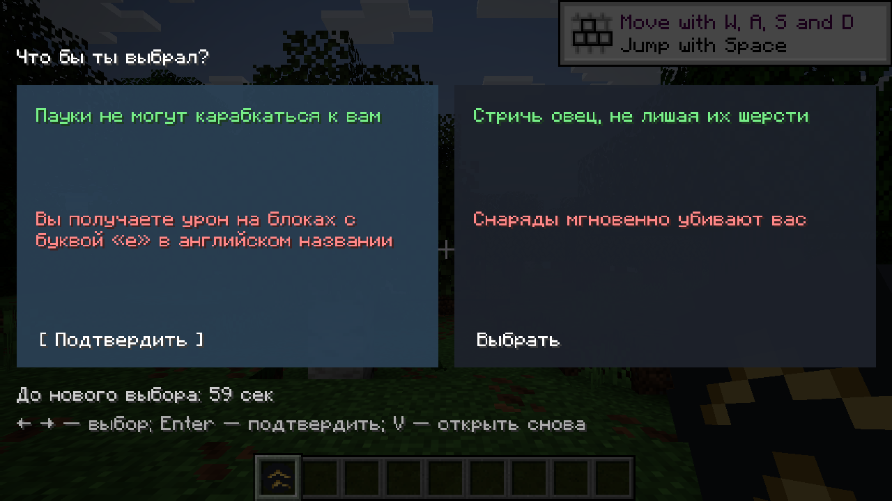
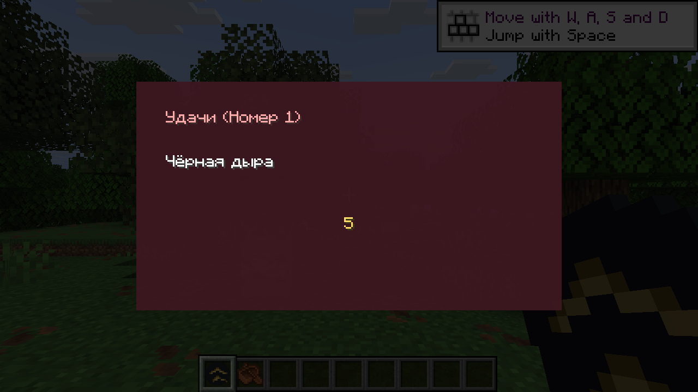
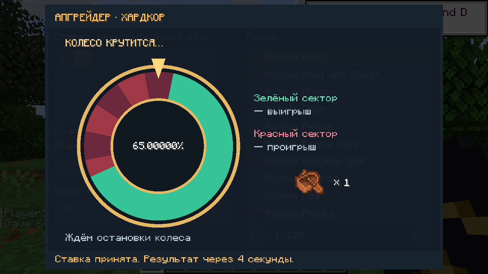

# WYR + Upgrader + катастрофы — Horizon RU

Личная сборка для Minecraft Java 26.3 на движке Horizon. Один мод объединяет русскую версию Would You Rather, хардкорный Upgrader с вращающейся рулеткой и шесть катастроф из Orbital Laser.

## Поведение

- WYR обычно предлагает два варианта слева и справа: бонус вместе с проклятием.
- Катастрофа заменяет предложение одной центральной карточкой «Удачи (Номер …)». После отсчёта 5 → 0 запускается автоматически в текущих координатах игрока.
- Если выпали две катастрофы, случайно выбирается только одна. Второй запуск из того же предложения не создаётся.
- Каждая катастрофа имеет такой же вес в пуле случайных отрицательных событий, как отдельное обычное событие. Повторяемость и доступность других эффектов влияют на размер пула.
- Апгрейдер выдаётся при первом входе; можно выбрать желаемый предмет и количество. Цены усложнены, результат ставки задаёт сервер, колесо показывает вращение и остановку.

| Номер | Катастрофа |
|---|---|
| 1 | Black Hole — Чёрная дыра |
| 2 | Meteor Storm — Метеоритный шторм |
| 3 | Planet Killer — Убийца планет |
| 4 | Rod from God — Жезл Бога |
| 5 | Sinkhole — Провал грунта |
| 6 | Payload — Боевой заряд |

## Установка в официальный Horizon Launcher

В версии 0.3.0 нужен один файл **wyr.hnmod** из Releases. Он содержит WYR, Upgrader, катастрофы и ресурсы. Отдельный EXE и Start.cmd не нужны.

1. Закройте игру. В папке экземпляра откройте horizon-native-mods.
2. Перенесите старые orbital.hnmod, upgrader_hardcore.hnmod и wyr.hnmod в резервную папку вне horizon-native-mods.
3. Положите новый wyr.hnmod в horizon-native-mods.
4. В официальном лаунчере включите мод wyr и нажмите «Собрать» в строке нативной компиляции, затем «Играть».

Все компоненты имеют один source pin Horizon и одну версию horizon-mixins. Ошибка «сделан для другой версии Horizon» между тремя отдельными модами больше не возникает. Лаунчер сам собирает совместимую игровую версию. Нужны ваши собственные Minecraft Java 26.3 и подготовленные ресурсы.

V — WYR, U — Upgrader. Устройство выдаётся при первом входе. Для перехода со старого отдельного Upgrader предусмотрена однократная выдача нового устройства при необходимости. Катастрофы меняют ландшафт — используйте отдельный тестовый мир.

## Разработка

Исходники нативного упаковщика находятся в WyrHorizon/fork/build_native.py. Он объединяет все компоненты и ресурсы в один wyr.hnmod. Зависимости закреплены в PROVENANCE.json. Старый Windows-пакет 0.2.0 остаётся в истории Releases и больше не является основным способом установки.

## Проверка и ограничения

Общая проверка компиляции прошла; восемь тестов логики WYR и шесть тестов Upgrader прошли. Шейдеры четырёх визуальных эффектов WYR прошли проверку Naga. Итоговый игровой прогон отражается отдельно в [VALIDATION.md](VALIDATION.md).

Катастрофы сейчас исполняются через окно владельца локального мира. Для гостя требуется, чтобы владелец находился в том же измерении. Выделенный сервер без окна владельца пока не поддерживается: событие остаётся в ожидании. Шейдерные эффекты WYR адаптированы к Horizon; они не повторяют Java GLSL побитово.

## Источники

WYR — EightSidedSquare; Upgrader — EXEcheINZ. Исходные JAR и декомпилированные файлы в репозиторий не включены; оригинальные ресурсы берутся из ваших JAR при личной упаковке. Orbital Laser — [Stink-O/orbital-laser](https://github.com/Stink-O/orbital-laser), MIT; его лицензия и NOTICE сохранены. Версии зависимостей: [PROVENANCE.json](PROVENANCE.json).

## Скриншоты игрового теста

